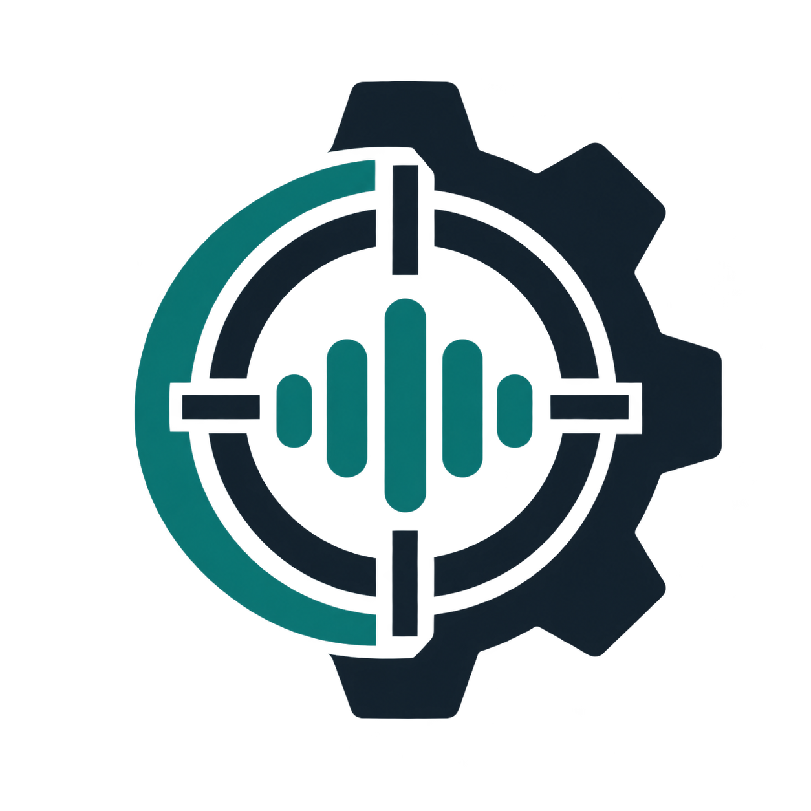

# VoiceInspect · 工业设备多模态智能诊断平台

<p align="center">
  
</p>

<p align="center">
  面向工业设备运维场景，将文字、语音、图片、知识依据和人工故障处置连接成可追踪闭环。
</p>

> 当前定位：可用于 Windows 本地 Docker（容器平台）环境的内部业务试点。
>
> 安全边界：AI（人工智能）只提供辅助诊断和证据整理；所有疑似故障必须由人员确认后才能进入业务闭环。

---

## 目录

- [一、项目解决什么问题](#一项目解决什么问题)
- [二、核心能力](#二核心能力)
- [三、系统架构](#三系统架构)
- [四、技术栈](#四技术栈)
- [五、完整业务流程](#五完整业务流程)
- [六、快速开始](#六快速开始)
- [七、模型与能力配置](#七模型与能力配置)
- [八、知识库与公开数据](#八知识库与公开数据)
- [九、角色与演示账号](#九角色与演示账号)
- [十、项目结构](#十项目结构)
- [十一、测试与质量状态](#十一测试与质量状态)
- [十二、深入文档](#十二深入文档)
- [十三、当前边界](#十三当前边界)
- [十四、安全说明](#十四安全说明)

---

## 一、项目解决什么问题

工业现场的设备故障信息通常分散在操作员描述、录音、仪表照片、维修手册和历史记录中。单纯接入一个聊天模型并不能解决真实业务问题：

1. **现场信息不完整**：文字、语音和图片彼此分离，交接时容易丢失证据。
2. **回答缺少设备依据**：通用模型不了解当前组织、设备类型、型号和已发布手册。
3. **图片识别不等于故障确认**：识别到设备外观并不能证明内部故障，异常必须关联可见证据。
4. **诊断与维修流程脱节**：得到建议后仍需要确认、分派、处理、验证和关闭。
5. **模型任务不稳定**：推理耗时、网络中断、重复提交和局部能力失败都可能破坏用户体验。
6. **结果难以审计**：如果不保留原始附件、知识引用、状态事件和处理记录，就无法复核结论。

VoiceInspect 的解决思路不是让模型直接替代维修人员，而是建立一条可审计的数据链：

```text
现场文字 / 语音 / 图片
          ↓
设备上下文与结构化观察
          ↓
知识检索与确定性规则
          ↓
带引用的辅助诊断建议
          ↓
人工确认故障
          ↓
分派 → 处理 → 验证 → 关闭
          ↓
报告、通知与审计
```

首期覆盖四类设备：

- 空压机；
- 液压系统；
- 驱动电机；
- 通用加工设备。

---

## 二、核心能力

### 2.1 多模态诊断

- 支持文字、现场录音和设备图片组合输入；
- 图片和语音与文字一次发送，不需要拆成多轮消息；
- 发送成功后附件进入会话历史，刷新页面后仍可恢复；
- 未提供的输入类型标记为“已跳过”，不会误判为能力失败；
- 单项能力失败不会清空其他有效输入。

### 2.2 结构化视觉分析

视觉处理不是直接询问“设备有什么故障”，而是拆成两步：

1. 提取客观观察、仪表读数、设备部件和图片质量；
2. 基于已观察证据生成疑似异常和安全提示。

每个异常必须关联至少一条图片观察。图片模糊、遮挡、设备类型不匹配或没有异常证据时，结果进入人工复核，不生成确定性故障结论。

### 2.3 RAG（检索增强生成）知识检索

- 只检索当前组织可访问的资料；
- 只检索已发布且未停用的文档；
- 按设备类型和设备型号过滤；
- 区分制造商手册、维护指南、安全资料、故障案例和数据集说明卡；
- 通用资料明确标记为通用依据，不伪装成型号手册；
- 返回来源、版本、章节、页码和原始片段；
- 向量服务异常时，只在相同权限和设备候选范围内执行受限词法回退。

### 2.4 证据分区回答

诊断结果不是一段无法核对的聊天文本，而是按来源分区：

- 图片直接观察；
- 仪表和测量值；
- 疑似异常；
- 知识库事实；
- 可能原因；
- 推荐检查；
- 安全措施；
- 不确定性；
- 引用依据。

原始 Markdown（轻量标记语言）保存在数据库，前端使用 `markdown-it`（标记语言解析器）渲染，并通过 `DOMPurify`（网页内容清洗库）过滤脚本、事件属性和危险链接。

### 2.5 持久化后台任务

模型、语音和报告等耗时操作不会阻塞普通 API（应用程序编程接口）请求。系统使用数据库任务队列和独立 Worker（后台任务进程）执行：

- STT（语音转文字）；
- Vision（视觉分析）；
- RAG（检索增强生成）；
- LLM（大语言模型）回答；
- TTS（文字转语音）；
- 报告生成。

任务支持排队、运行、重试、成功、部分有效、失败和取消，并通过租约恢复异常中断的任务。

### 2.6 流式回答与断线恢复

- 使用 SSE（服务器发送事件）持续推送状态和回答片段；
- 正确识别 `[DONE]`（流结束标志），不把它作为 JSON（JavaScript 对象表示法）解析；
- 事件按递增序号持久化；
- 页面刷新后从最后事件继续恢复，不重新调用模型；
- 模型片段批量写入数据库，避免逐字提交产生大量事务。

### 2.7 故障处理闭环

```text
新建 → 已确认 → 处理中 → 待验证 → 已关闭
```

- 维修主管确认、分派、改派、验证和关闭；
- 负责人只能从同组织在岗操作员或维修主管中选择；
- 被分派操作员可以提交现场处理结果，但不能确认、改派、验证或关闭；
- 故障详情展示位置、现场证据、上一处理结果、负责人和完整时间线；
- 关闭前必须填写处理结果和验证依据；
- 每次操作同时写入故障事件和审计事件。

### 2.8 企业后台能力

- 运营总览；
- 多模态诊断；
- 诊断会话管理与批量删除；
- 故障闭环与负责人待办；
- 设备资产和历史记录；
- 知识导入、索引、审核、发布和停用；
- 报告生成、进度查询和鉴权下载；
- 通知中心、一键已读和故障跳转；
- 用户、会话和组织范围管理；
- 审计事件查询；
- 模型提供者和能力健康状态。

---

## 三、系统架构

```text
┌──────────────────────────────────────────────────────────────┐
│ Vue 3（渐进式前端框架）                                      │
│ 诊断 / 会话 / 故障 / 设备 / 知识 / 报告 / 审计 / 账号         │
└───────────────────────────┬──────────────────────────────────┘
                            │ HTTP（超文本传输协议）/ SSE（服务器发送事件）
┌───────────────────────────▼──────────────────────────────────┐
│ FastAPI（Python 高性能接口框架）                              │
│ 身份验证 / 角色权限 / 组织范围 / 参数校验 / 幂等 / 任务创建   │
└───────────────────────────┬──────────────────────────────────┘
                            │ 数据库任务队列
┌───────────────────────────▼──────────────────────────────────┐
│ Worker（后台任务进程）                                       │
│ 语音 / 视觉 / 检索 / 文本生成 / 报告 / 重试 / 租约恢复        │
└───────────────┬───────────────────────────────┬──────────────┘
                │                               │
┌───────────────▼────────────────┐  ┌───────────▼──────────────┐
│ 模型能力                        │  │ 数据与文件                │
│ 千问云端或 Ollama（本地模型运行器）│  │ SQLite（嵌入式关系数据库）│
│ Faster-Whisper（语音识别实现）   │  │ 上传 / 知识 / 报告 / 日志 │
└────────────────────────────────┘  └──────────────────────────┘
```

### 3.1 三条核心数据链

1. **诊断链**：用户输入 → 能力任务 → 结构化证据 → 知识检索 → 诊断回答。
2. **故障链**：诊断建议 → 人工确认 → 分派 → 处理 → 验证 → 关闭。
3. **审计链**：关键写操作 → 故障事件和审计事件 → 报告与追踪。

### 3.2 关键设计原则

- 接口进程只负责快速校验和任务创建，耗时推理由后台任务执行；
- 权限和组织过滤必须在数据库查询阶段执行，不能依赖前端隐藏按钮；
- 模型负责语义提取和解释，代码负责权限、状态、阈值和证据约束；
- 原始附件、结构化结果和最终回答分别保存；
- 技术执行状态与诊断证据置信度分开表达；
- 没有可靠资料时明确拒绝绑定引用，不通过降低阈值制造依据。

---

## 四、技术栈

| 层级 | 技术 | 主要职责 |
|---|---|---|
| 前端 | `Vue 3`（渐进式前端框架） | 页面和响应式交互 |
| 前端类型 | `TypeScript`（带类型的脚本语言） | 类型约束和接口模型 |
| 前端构建 | `Vite`（前端构建工具） | 开发服务器和生产构建 |
| 路由 | `Vue Router`（Vue 路由工具） | 企业后台页面导航 |
| 后端 | `FastAPI`（Python 高性能接口框架） | 接口、依赖注入和鉴权 |
| 数据校验 | `Pydantic`（Python 数据校验库） | 请求、配置和模型输出结构校验 |
| 数据访问 | `SQLAlchemy`（对象关系映射工具） | 数据模型和数据库查询 |
| 数据迁移 | `Alembic`（数据库迁移工具） | 数据库版本升级 |
| 数据库 | `SQLite`（嵌入式关系数据库） | 内部试点业务数据和任务事件 |
| 文本与视觉模型 | 千问云端兼容接口或 `Ollama`（本地模型运行器） | 图片观察、诊断解释和建议生成 |
| 文本向量 | `bge-large-zh`（中文文本向量模型） | 知识切片向量化与检索 |
| 语音识别 | `Faster-Whisper`（高效语音转文字实现） | 现场录音转写 |
| 文档处理 | `PyMuPDF`（PDF 文档处理库）、`python-docx`（Word 文档处理库） | 知识文档解析 |
| 前端安全 | `DOMPurify`（网页内容清洗库） | 清洗模型生成内容 |
| 单元测试 | `pytest`（Python 测试框架）、`Vitest`（前端测试框架） | 后端和前端回归测试 |
| 部署 | `Docker Compose`（多容器编排工具） | 网页、接口和后台任务分离运行 |

---

## 五、完整业务流程

### 5.1 一次图片诊断

1. 用户选择当前设备；
2. 上传图片并输入现场描述；
3. 后端校验文件签名、媒体类型、大小、像素和访问权限；
4. 用户消息和附件关系先写入数据库；
5. 接口创建后台任务并立即返回任务编号；
6. 后台任务校正图片方向并执行视觉分析；
7. 视觉模型输出观察、测量值、疑似异常和不确定项；
8. 确定性规则检查设备匹配、数值阈值、安全信号和证据关联；
9. 知识服务检索当前设备适用资料；
10. 文本模型按证据分区生成回答；
11. 页面通过 SSE（服务器发送事件）持续接收内容；
12. 完整回答、引用、图片和任务状态保存到会话历史。

### 5.2 一次故障处理

1. 用户根据诊断建议补充故障位置和现场证据；
2. 维修主管确认故障；
3. 主管选择同组织在岗负责人；
4. 负责人查看历史处理说明并提交本次处理结果；
5. 故障进入待验证状态；
6. 主管填写验证依据并关闭；
7. 系统保留故障事件、操作人、时间和审计记录；
8. 用户可生成包含证据、引用和处理过程的报告。

---

## 六、快速开始

### 6.1 环境要求

- Windows 10 或 Windows 11；
- Python 3.13；
- Node.js（JavaScript 运行时）和 npm（Node.js 包管理器）；
- Docker Desktop（桌面容器平台，可选但推荐）；
- 使用本地模型时需要 Ollama（本地模型运行器）；
- 使用千问云端模型时需要阿里云百炼 API Key（应用程序编程接口密钥）。

### 6.2 Docker（容器平台）启动

复制示例配置：

```powershell
Copy-Item .env.example .env
```

编辑 `.env`（环境变量文件），至少替换访问令牌密钥和演示账号密码。随后执行：

```powershell
docker compose build api web worker
docker compose up -d
docker compose ps
```

访问地址：

- 网页：http://127.0.0.1:5173
- API（应用程序编程接口）：http://127.0.0.1:8000
- 健康检查：http://127.0.0.1:8000/api/v1/health

容器启动时，接口服务会先执行 Alembic（数据库迁移工具）升级。Worker（后台任务进程）等待接口健康后启动。

### 6.3 本地开发启动

安装后端：

```powershell
python -m venv .venv
.\.venv\Scripts\Activate.ps1
python -m pip install --upgrade pip
python -m pip install -e ".[test,audio]"
Copy-Item .env.example .env
.\.venv\Scripts\alembic.exe upgrade head
```

启动接口：

```powershell
.\.venv\Scripts\python.exe -m uvicorn apps.api.main:app --host 127.0.0.1 --port 8000 --reload
```

启动后台任务进程：

```powershell
.\.venv\Scripts\python.exe -m backend.workers.runner
```

启动前端：

```powershell
npm install
npm run dev
```

---

## 七、模型与能力配置

### 7.1 千问云端文本与视觉

在 `.env`（环境变量文件）中配置：

```dotenv
MODEL_PROVIDER=qwen
QWEN_API_KEY=<请填写新生成的密钥>
QWEN_BASE_URL=https://dashscope.aliyuncs.com/compatible-mode/v1
QWEN_MODEL=qwen3.7-flash
QWEN_ENABLE_THINKING=true
QWEN_MAX_TOKENS=512
QWEN_VISION_MAX_TOKENS=1536
```

文本和视觉可以使用同一千问模型提供者。密钥只允许保存在本地 `.env`（环境变量文件）或部署平台密钥管理中，不能提交到 Git。

### 7.2 本地 Ollama（本地模型运行器）

示例配置：

```dotenv
MODEL_PROVIDER=ollama
OLLAMA_BASE_URL=http://127.0.0.1:11434
OLLAMA_LLM_MODEL=qwen2.5:7b-instruct-q4_K_M
OLLAMA_VISION_MODEL=qwen2.5vl:3b
OLLAMA_EMBED_MODEL=quentinz/bge-large-zh-v1.5:latest
```

Docker（容器平台）中的接口和后台任务通过 `host.docker.internal`（容器访问宿主机地址）连接宿主机 Ollama（本地模型运行器），不能使用容器内部的 `localhost`（本机回环地址）。

### 7.3 性能保护

```dotenv
WORKER_MAX_ACTIVE_DIAGNOSIS=1
WORKER_LEASE_SECONDS=300
DIAGNOSIS_STREAM_FLUSH_MS=600
DIAGNOSIS_STREAM_FLUSH_CHUNKS=32
OLLAMA_EMBED_NUM_GPU=0
OLLAMA_EMBED_NUM_THREADS=4
```

默认只允许一个诊断任务占用模型，文本向量计算使用 CPU（中央处理器），避免与文本或视觉模型争用 GPU（图形处理器）。流式片段按数量和时间批量持久化，降低 SQLite（嵌入式关系数据库）事务压力。

---

## 八、知识库与公开数据

### 8.1 文档生命周期

```text
已上传 → 已解析 → 已建立索引 → 已发布 → 已停用
```

只有已发布且未停用的文档参与诊断检索。

### 8.2 内置设备知识包

项目在 `data/knowledge/packs/`（设备知识包目录）中提供：

- 空压机维护知识包；
- 液压系统维护知识包；
- 驱动电机维护知识包；
- 通用加工设备维护知识包；
- 能源隔离和现场证据知识包。

导入并发布：

```powershell
.\.venv\Scripts\python.exe scripts\seed_device_knowledge.py --publish
.\.venv\Scripts\python.exe scripts\seed_public_knowledge.py --publish
```

### 8.3 公开数据集

项目登记的公开工业数据包括：

- MetroPT-3 空压机数据；
- AI4I 2020 预测性维护数据；
- UCI（加州大学欧文分校机器学习库）液压系统数据；
- Sensorless Drive Diagnosis（无位置传感器驱动诊断）数据；
- IIT Kanpur（印度理工学院坎普尔分校）空压机声学数据来源。

数据集说明卡只用于解释数据来源、字段、许可证和算法适用范围，不直接作为维修结论依据。原始数据默认写入被 Git 忽略的本地目录。

---

## 九、角色与演示账号

开发环境可以启用演示数据和一键账号填充：

| 账号 | 默认密码 | 角色 | 主要职责 |
|---|---|---|---|
| `operator` | `change-me` | 操作员 | 诊断、查看故障、提交被分派任务的处理结果 |
| `supervisor` | `change-me-supervisor` | 维修主管 | 确认、分派、验证和关闭故障 |
| `knowledge-admin` | `change-me-knowledge` | 知识管理员 | 导入、审核、发布和停用知识 |
| `admin` | `change-me-admin` | 系统管理员 | 全局用户、组织、权限和系统配置 |

> 演示密码只能用于本地开发。正式部署必须设置 `SEED_DEMO_DATA=false`，替换所有密钥和密码，并通过管理员初始化脚本创建正式账号。

正式管理员初始化：

```powershell
.\.venv\Scripts\python.exe scripts\provision_admin.py --username plant-admin
```

---

## 十、项目结构

```text
VoiceInspect/
├─ apps/api/                       # 接口服务入口
├─ backend/
│  ├─ api/                         # 身份、诊断、故障、知识、报告等接口
│  ├─ core/                        # 配置、安全和共享基础能力
│  ├─ migrations/                  # Alembic（数据库迁移工具）版本
│  ├─ providers/                   # 文本、视觉、语音和向量模型提供者
│  ├─ rag/                         # RAG（检索增强生成）服务
│  ├─ repositories/                # SQLAlchemy（对象关系映射工具）模型
│  ├─ services/                    # 诊断、附件和报告业务服务
│  └─ workers/                     # 数据库任务队列和后台任务进程
├─ frontend/src/
│  ├─ components/                  # 通用组件和证据展示
│  ├─ views/                       # 企业后台页面
│  ├─ utils/                       # Markdown（轻量标记语言）和设备问题工具
│  └─ api.ts                       # 前端接口客户端
├─ data/
│  ├─ knowledge/                   # 可版本化通用知识和本地知识数据
│  ├─ datasets/                    # 数据集目录和派生说明卡
│  ├─ vision/                      # 视觉评测集及清单
│  ├─ uploads/                     # 用户上传文件，本地持久化且不提交
│  ├─ exports/                     # 报告文件，本地持久化且不提交
│  └─ db/                          # SQLite（嵌入式关系数据库）文件
├─ docs/                           # 架构、面试、运行和质量文档
├─ evals/                          # AI（人工智能）能力评测
├─ scripts/                        # 初始化、导入、备份和恢复脚本
├─ tests/                          # 后端单元和集成测试
├─ compose.yaml                    # Docker Compose（多容器编排工具）
├─ Dockerfile.api                  # 接口与后台任务镜像
└─ Dockerfile.web                  # 网页镜像
```

---

## 十一、测试与质量状态

### 11.1 验证命令

```powershell
.\.venv\Scripts\python.exe -m pytest -q
npm run build
npm run test:unit
npm run verify:premium
docker compose build api web worker
docker compose up -d
```

### 11.2 最近一次本地验证

验证日期：2026-10-14。

| 检查项 | 结果 |
|---|---|
| 后端测试 | 46 项通过 |
| 前端生产构建 | 通过 |
| 前端单元测试 | 8 项通过 |
| 界面规范检查 | 通过 |
| Git（版本控制工具）敏感密钥扫描 | 未发现真实密钥特征 |
| Docker（容器平台）镜像重建 | 未验证：本机 Linux 容器引擎未就绪 |

需要明确区分：代码测试通过不等于真实现场诊断准确率通过；Docker（容器平台）桌面进程启动也不等于 Linux 容器引擎和项目容器已经健康。

---

## 十二、深入文档

### 12.1 理解实现

- [架构与代码实现深度解析](docs/ARCHITECTURE-DEEP-DIVE.md)
- [多模态质量方案](docs/MULTIMODAL-QUALITY.md)
- [运行、迁移、备份与恢复手册](docs/RUNBOOK.md)
- [内部试点发布准备](docs/RELEASE-READINESS.md)

### 12.2 答辩和面试

- [项目面试简介](docs/项目面试简介.md)
- [面试深度复盘与实现说明](docs/面试深度复盘与实现说明.md)
- [答辩 PPT（演示文稿）提纲与扩展讲解](docs/答辩PPT提纲与扩展讲解.md)
- [项目演示与 20 分钟讲稿](docs/项目演示与20分钟讲稿.md)

### 12.3 合规

- [第三方资料与许可证说明](docs/THIRD_PARTY_NOTICES.md)

---

## 十三、当前边界

当前可以确认：

- 系统具备内部业务试点所需的账号、权限、诊断、知识、任务、故障、报告和审计流程；
- 文字、语音和图片能力可以独立执行和降级；
- 诊断结果保留证据、引用和不确定性；
- 故障必须由人员确认并完成业务闭环。

当前不能宣称：

- 已通过真实工业现场诊断准确率验收；
- 已完成企业 SSO（单点登录）接入；
- 已接入 CMMS（计算机化维护管理系统）、MES（制造执行系统）或 ERP（企业资源计划系统）；
- 已完成 PostgreSQL（开源关系数据库）或 MySQL（关系数据库）的生产迁移验证；
- 已具备多人、多节点和高可用生产部署能力；
- 公开数据集和合成图片可以替代企业真实设备数据。

---

## 十四、安全说明

- 不要把 `.env`（环境变量文件）、模型密钥、数据库文件、上传文件或报告文件提交到仓库；
- 正式部署必须替换 `ACCESS_TOKEN_SECRET`（访问令牌密钥）和全部演示密码；
- 厂商手册只有在拥有使用权时才能导入私有知识库；
- 前端隐藏菜单不是安全边界，所有权限必须由服务端执行；
- 下载附件和报告时必须再次鉴权；
- 模型输出不能直接修改故障状态；
- 泄漏过的 API Key（应用程序编程接口密钥）必须在服务提供方控制台吊销，而不是只从代码中删除。

---

## 项目状态总结

VoiceInspect 已经从“调用模型回答设备问题”的原型，演进为具备持久化任务、证据约束、知识治理、角色权限、故障闭环、报告和审计的内部试点平台。

下一阶段重点不是继续堆叠页面，而是引入真实设备资料和现场失败样本，对四类设备分别执行准确率、误报率、引用有效率和性能评测，并根据结果决定是否进入正式生产扩展。
